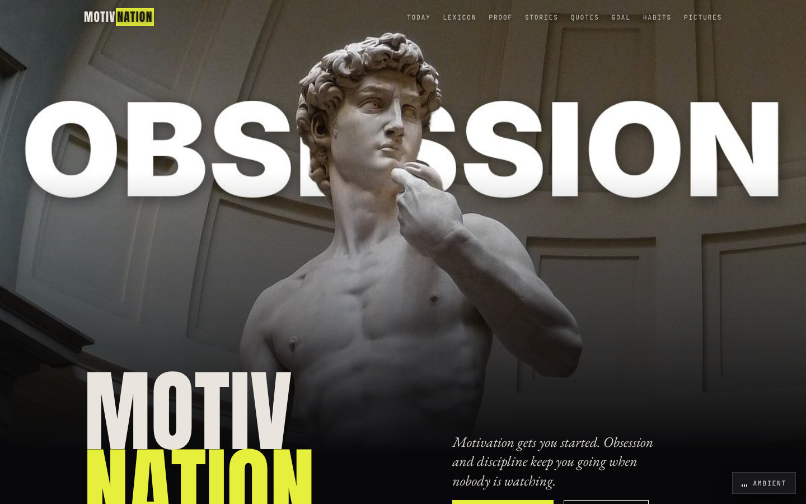
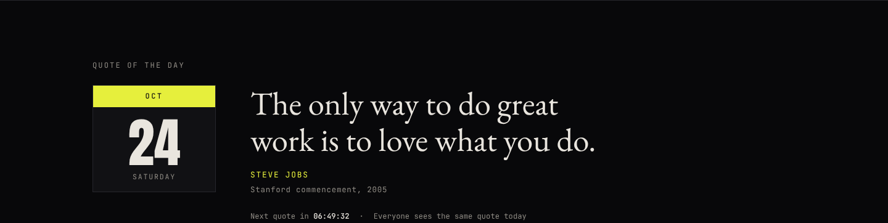
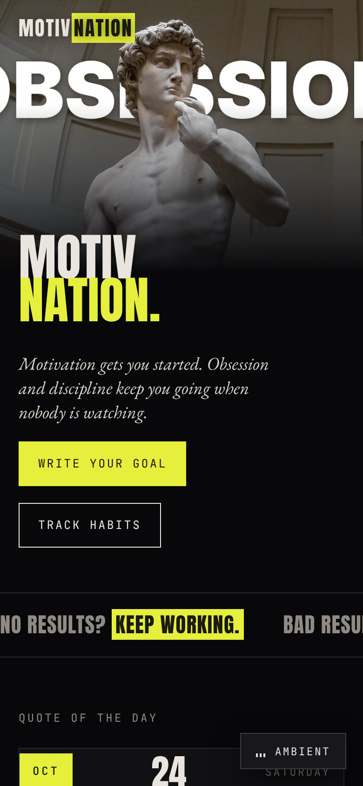
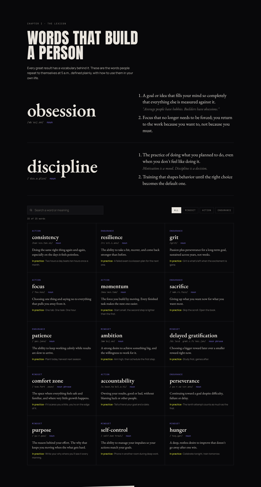
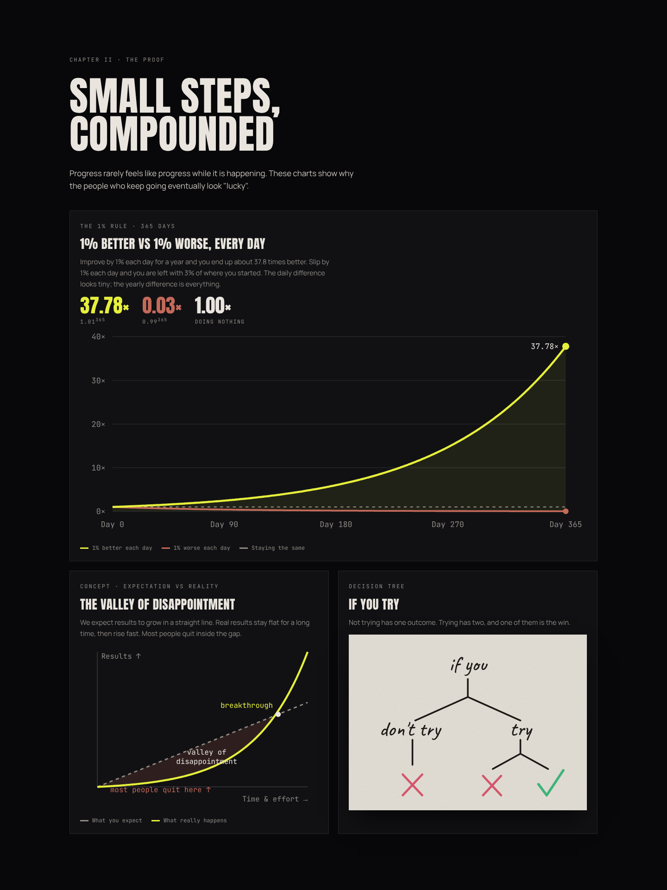
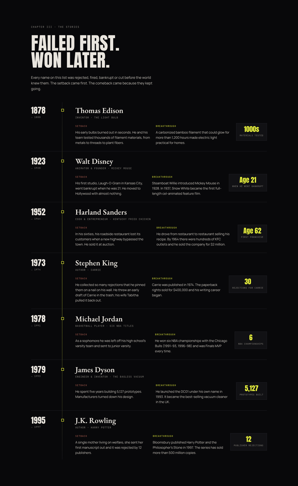
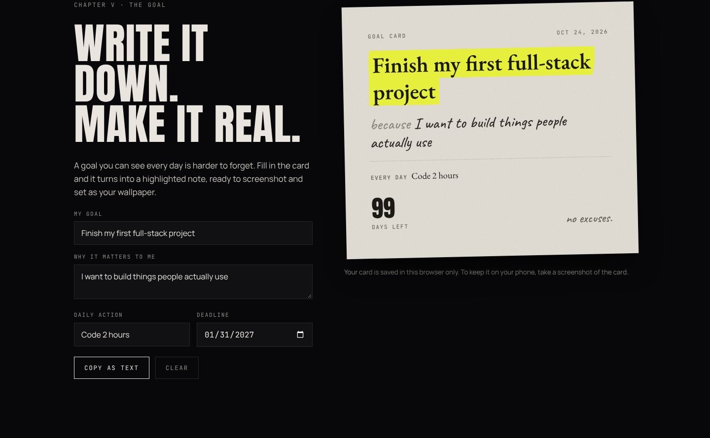
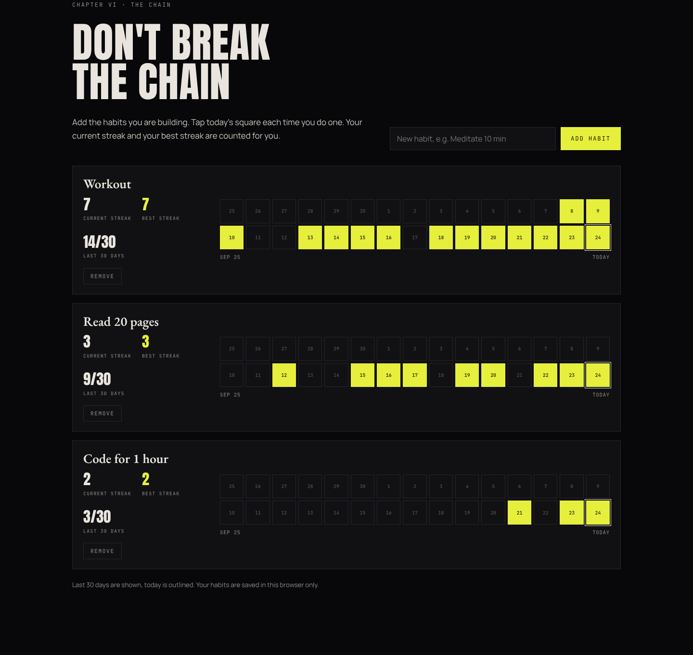
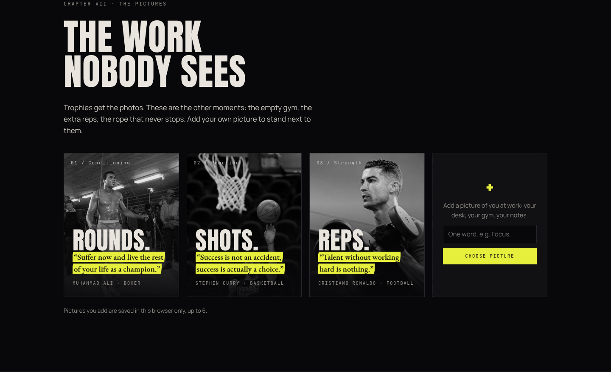

# Motivnation

A dark, single-page motivation website: obsession, discipline and the work nobody sees.



## Screenshots

| Quote of the day | Mobile |
|---|---|
|  |  |

### Lexicon


### The Proof


### Success stories


### Goal card


### Habit tracker


### Pictures


> Goal card and habit screenshots use sample data.

## Features

- **Hero** – marble statue with *OBSESSION*, fading into black
- **Quote of the day** – changes every day, same quote for every visitor
- **Lexicon** – 17 words (obsession, discipline, grit, patience…) with search and category filters
- **The Proof** – 1% rule chart (1.01³⁶⁵ ≈ 37.78×), valley of disappointment, "if you try" tree
- **Reel** – scroll-driven full-screen statements that blur in and sharpen
- **Stories** – Edison, Disney, Sanders, King, Jordan, Dyson, Rowling: setback → breakthrough
- **Quotes** – 30 attributed quotes with a rotator and copy button
- **Goal Card** – write your goal and why, rendered as a highlighted paper note
- **Habit tracker** – multiple habits, 30-day chain, current and best streak
- **Pictures** – training photos plus your own uploads
- **Ambient sound** – generated focus drone and rain (Web Audio, no audio files)

Goal card, habits and uploaded pictures are saved in the visitor's browser (localStorage).

## Run locally

Open `index.html` in a browser. No build step, no dependencies.

## Publish with GitHub Pages

1. Push this folder to a repository.
2. Go to **Settings → Pages**.
3. Under **Source**, choose **Deploy from a branch**, select `main` and `/ (root)`, then **Save**.
4. After a minute the site is live at `https://<username>.github.io/<repo>/`.

## Structure

```
index.html        page, styles and scripts
assets/           hero and gallery images
screenshots/      images used in this README
```

## Credits

Fonts: Anton, EB Garamond, Manrope, JetBrains Mono, Caveat (Google Fonts).
Photos in `assets/` belong to their respective owners and are used for non-commercial, personal purposes.
